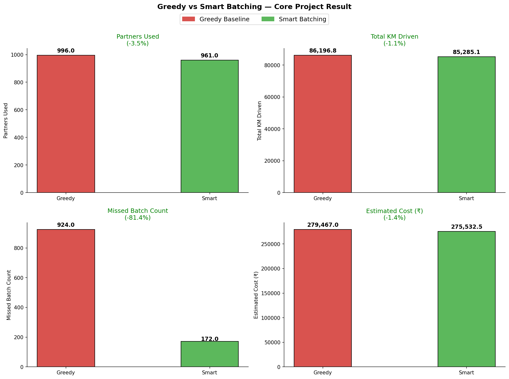
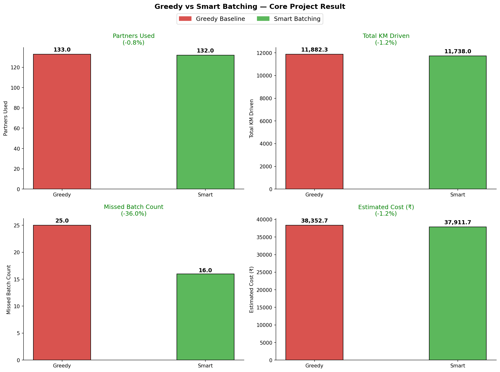

# Zomato Batching: Can Smarter Order Batching Cut Delivery Distance, Cost and Emissions?

A simulation of food-delivery order batching on two synthetic Indian cities, Hubli-Dharwad (Tier 2) and Hyderabad (Tier 1), built from public Eternal (Zomato) annual-report data to test how much distance, cost and CO2e could be saved when nearby orders share one delivery partner.

## The story behind it

One evening, two friends and I ordered from the same restaurant to the same campus destination between 8:21 and 8:23 PM. Zomato assigned three separate delivery partners. I started wondering whether that kind of inefficiency matters at scale. The full story is in [docs/motivation.md](docs/motivation.md), and the three bills (personal details redacted) are in [docs/evidence/](docs/evidence/).

**An honest framing:** this is a simulation on synthetic cities using public data. Three orders are an anecdote, not proof, and I cannot see Zomato's real dispatch logic. The simulation tests whether the pattern could matter at scale.

## Results

Change versus a greedy dispatch baseline. **Q** is the conservative scenario (orders within a 1.5 km proximity threshold taken from the literature). **Avg** is the primary scenario (the mean of Q and a more aggressive same-zone-only scenario, P). Full Q / Avg / P detail is in [docs/key_findings.md](docs/key_findings.md).

| | Hubli-Dharwad Q | Hubli-Dharwad Avg | Hyderabad Q | Hyderabad Avg |
|---|---|---|---|---|
| Partners used | -0.8% | -18.0% | -3.5% | -7.0% |
| Total distance | -1.2% | -0.9% | -1.1% | -1.0% |
| Missed batch count | -36.0% | -36.0% | -81.4% | -81.3% |
| Estimated daily cost | -1.2% | -3.3% | -1.4% | -1.8% |
| Annual saving (Rs crore, simulated city) | 0.0161 | 0.0461 | 0.1436 | 0.1861 |

National projection (Avg scenario, based on about 2.36 million daily orders): about **2,580 tonnes CO2e per year** (range 2,248 to 2,912), about 1,096,274 litres of petrol per year, and a rough equivalent of 43,005 trees (illustrative only).

## How it works

The project flow, from city construction to the national projection, is in [docs/project_flow.md](docs/project_flow.md). Methods are in [docs/methodology.md](docs/methodology.md) and the formulas in [docs/formulas.md](docs/formulas.md).

## Repository map

| Folder | Contents |
|---|---|
| `notebooks/` | Colab notebooks for Hubli-Dharwad, Hyderabad and the national models |
| `data/` | Generated city, restaurant and order files for each city |
| `models/` | Trained classifiers for each city |
| `results/` | Metrics and dispatch logs for the baseline, batching and national runs |
| `figures/` | Charts for each stage |
| `docs/` | Motivation, methodology, findings, limitations and evidence |

## How to run

The notebooks run in Google Colab. Install pinned libraries from `requirements.txt` if you run locally. Run order, upload tables and file names are in [notebooks/README.md](notebooks/README.md). Keep the two cities' files separate.

## Limitations

Synthetic cities, generated destinations, an unknown real dispatch logic and a two-city scaling assumption all limit what these results show. See [docs/limitations.md](docs/limitations.md).

## Data sources

- Eternal annual reports, FY24 to FY26
- CDP Scope 3 emissions disclosures
- Census of India

## Author and contact

Ankit Jangir (Kakarot), Data Science and AI student at IIIT Dharwad

- GitHub: [ankitjangir-ai](https://github.com/ankitjangir-ai)
- LinkedIn: [Ankit Jangir](https://www.linkedin.com/in/ankit-jangir-34831b327)
- Email: ankitjangir112233@gmail.com

Released under the MIT License.
